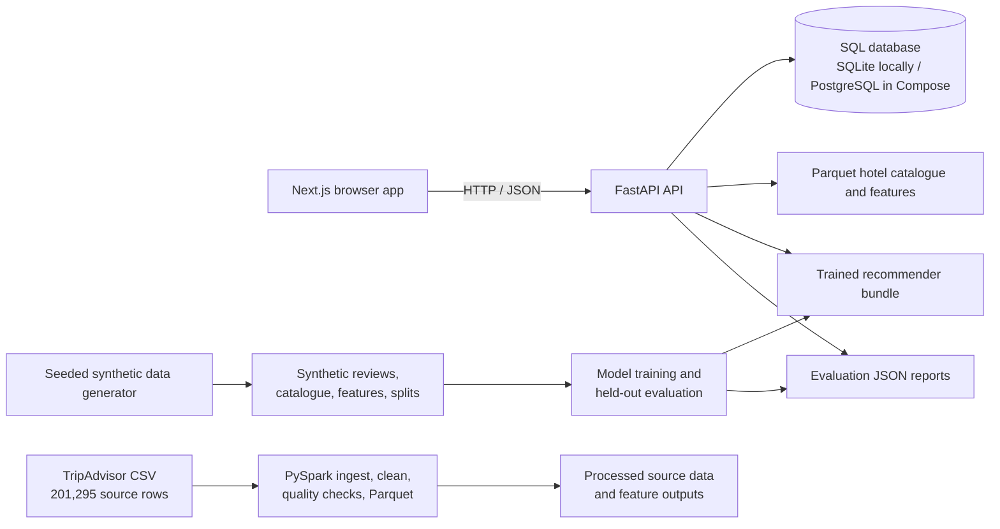

# TripSense AI — Project Guide

This guide explains the implemented project: its technology stack, data and model
pipelines, application architecture, user-facing features, setup, and known
limitations. It distinguishes the real TripAdvisor source dataset from the
separate synthetic dataset used to train and evaluate the recommendation models.

## 1. What the project does

TripSense AI is a hotel-discovery and recommendation application. A visitor can
browse a hotel catalogue, get ranked recommendations, and inspect hotel details.
An account lets a traveler save hotels, store recommendation preferences, and
submit rated reviews. Submitted review text is analyzed for sentiment. Analytics
shows dataset statistics and model evaluation results.

The project has two different data/model tracks:

1. The **TripAdvisor source dataset** contains 201,295 reviews and is processed
   for data quality, statistics, and big-data pipeline demonstrations.
2. The **synthetic recommender dataset** has repeated user–hotel interactions,
   which support training and ranking evaluation. It contains 60,181 generated
   reviews (3,000 users and 500 hotels).

The ranking metrics in Analytics come from the synthetic data, not from the
TripAdvisor source. The source data has a unique `hotel_id` for each review, so
it cannot support a conventional repeat-interaction user–hotel ranking test.

## 2. System architecture



In normal use, the browser calls the API through the shared API client. The
backend loads catalogue/model artifacts and reads/writes account data through
SQLAlchemy. Data preparation and model training are offline commands; the
serving API does not train models on each request.

## 3. Technology stack

| Area | Technologies | Role |
|---|---|---|
| Web application | Next.js 16 App Router, React 19, TypeScript 5 | Pages, interactive controls, route rendering, and typed frontend code |
| Styling | Tailwind CSS 4 and project CSS | Responsive dark-themed interface and component styling |
| Frontend testing | Vitest, jsdom, Testing Library, ESLint, TypeScript | UI/API-client tests, lint, and type checking |
| API | Python, FastAPI, Uvicorn, Pydantic Settings | REST endpoints, validation, configuration, OpenAPI documentation |
| Relational persistence | SQLAlchemy, SQLite for local development; PostgreSQL driver and Docker Compose configuration | Accounts, preferences, saved hotels, and submitted reviews |
| Schema management | SQLAlchemy metadata creation at application startup; Alembic files are also present | Create relational tables and provide migration infrastructure |
| Authentication | bcrypt password hashing, signed JWT access tokens | Account authentication and protected endpoints |
| Data and ML | PySpark 3.5, pandas, NumPy, PyArrow/Parquet, scikit-learn, SciPy, scikit-surprise in training | Source-data processing, feature generation, recommender training and inference |
| Packaging | npm and Python requirements files; Dockerfiles and Docker Compose | Dependency installation and optional container deployment |

**Important Spark distinction:** Spark is used in the raw-data ingestion/cleaning
pipeline and benchmark work. The currently served recommender bundle is based on
the scikit-learn/SVD implementation in `ml/recsys/core.py`; the recommendation
API does not execute Spark jobs for every recommendation.

## 4. Repository map

| Path | Purpose |
|---|---|
| `apps/web/app/` | Next.js pages and route-level UI |
| `apps/web/components/` | Shared navigation, hotel-review list, analytics charts, and error boundary |
| `apps/web/lib/` | API functions, authentication context, and authenticated fetch helpers |
| `apps/web/__tests__/` | Frontend tests |
| `apps/api/main.py` | FastAPI application, startup lifespan, and router registration |
| `apps/api/routers/` | Authentication, hotel, recommendation, review, user, saved-hotel, analytics, and health endpoints |
| `apps/api/services/` | Business logic for hotel data, recommendations, model loading, authentication, and analytics |
| `apps/api/models/` and `apps/api/schemas/` | SQLAlchemy persistence models and Pydantic request/response shapes |
| `apps/api/alembic/` | Alembic migration configuration and revisions |
| `ml/pipelines/` | Spark ingestion, cleaning, and data-quality pipeline stages |
| `ml/scripts/` | Synthetic data generation and model training/evaluation |
| `ml/recsys/core.py` | Shared recommendation model definitions and scoring logic |
| `ml/evaluation/` | Source-data audit and saved evaluation reports |
| `data/raw/` | Original TripAdvisor CSV input |
| `data/processed/` | Generated Parquet files, catalogues, features, splits, and dataset statistics |
| `artifacts/models/` | Serialized model artifacts consumed by the API |
| `docs/model_cards/` | Model-specific descriptions |

## 5. Data and machine-learning flows

### 5.1 TripAdvisor source-data flow

The raw input is `data/raw/tripadvisor_reviews.csv`. The recorded row count is
201,295. Its fields include hotel and user IDs, review title/text, overall and
aspect ratings, stay year, post date, language, and derived text metadata.

The Spark pipeline in `ml/run_pipeline.py` coordinates the raw data stages:

1. **Ingest:** read the CSV with an expected schema and validate required fields.
2. **Clean:** remove duplicate `(user_id, hotel_id, post_date)` rows, drop rows
   missing required values, validate ratings, and add review identifiers.
3. **Quality checks:** summarize the data and check identity/interaction
   properties. A strict identity check is available.
4. **Write:** save cleaned data in Parquet format.
5. **Feature build:** `ml/build_features.py` can generate user, hotel, and text
   feature tables from processed data.

This is the project's real source-review dataset, but it does not provide a
normal hotel catalogue keyed by repeated hotel IDs: all 201,295 hotel IDs are
unique to a review in the verified report. The API therefore does not claim
real-source ranking quality from these data.

### 5.2 Synthetic recommender data flow

`ml/scripts/generate_synthetic_dataset.py` creates reproducible synthetic data
with seed 42. The generator defines 500 hotels, 3,000 users, 15 destinations,
user travel styles and aspect preferences, hotel attributes, ratings, and
template-generated review text. Each user has multiple reviews, enabling
user–hotel interaction modeling.

The generator writes the synthetic reviews, hotel catalogue, features, splits,
and `data/processed/dataset_stats.json`. The chronological per-user split keeps
each user's latest 20% of reviews for held-out testing.

### 5.3 Model training and evaluation

`ml/scripts/train_and_evaluate.py` trains and evaluates the recommendation
bundle and writes:

- The serving artifact under `artifacts/models/`.
- The held-out report in `ml/evaluation/results/synthetic_evaluation.json`.

The evaluation protocol fits on training data, tunes parameters and hybrid
weights on a validation split, and evaluates ranking on held-out reviews. The
ranking metrics use `K=10`; metrics are read from the generated report rather
than hardcoded into the Analytics chart.

### 5.4 Models

| Model | What it contributes |
|---|---|
| **Popularity baseline** | Ranks hotels by a rating/popularity prior; used as a simple comparison point |
| **Collaborative filtering (SVD)** | Learns user–hotel interaction patterns and can fold a new user's history into the model |
| **Content-based** | Compares a user's inferred or explicit preferences with hotel attributes and text-derived features |
| **Sentiment analysis** | Classifies review text as negative, neutral, or positive and produces sentiment scores/probabilities |
| **Hybrid ensemble** | Blends collaborative, content, and sentiment scores using validation-tuned weights |
| **Random baseline** | Seeded random ranking used as an evaluation floor |

The currently reported hybrid weights are 60% collaborative filtering, 30%
hotel content, and 10% review sentiment. They are evaluation outputs and may
change if the training/evaluation pipeline is rerun.

### 5.5 Verified source evaluation versus synthetic ranking evaluation

`ml/evaluation/run_verified_evaluation.py` audits/evaluates the source CSV
separately. In its current report, source ranking is not evaluable because test
items do not occur in the training catalogue. This is a property of the source
dataset, not a model score of zero.

The current Analytics API combines:

- Dataset cards from the **verified TripAdvisor source report** (201,295 reviews).
- Ranking charts and model benchmark table from the **synthetic evaluation
  report** (60,181 reviews).

The interface calls out this distinction and shows a data-limitation notice.
Do not compare the synthetic ranking metrics as if they were measured on real
TripAdvisor review interactions.

### 5.6 Metrics glossary

- **Average rating:** arithmetic mean of the source reviews' `overall` scores on
  the 1–5 scale.
- **Rating standard deviation:** how dispersed individual ratings are around
  their mean. It is not a confidence interval for the mean.
- **Matrix sparsity:** the percentage of possible user-by-hotel cells with no
  interaction. In this source data, the high value reflects the large number of
  possible reviewer/hotel combinations compared with observed reviews.
- **Train/test split:** training data is used to fit a model; held-out test data
  is reserved for final evaluation. The source evaluation uses a chronological
  80/20 split. The synthetic ranking benchmark uses each user's latest 20% for
  test.
- **K=10:** the ranking metrics score only the first ten recommendations.
- **Precision@10:** among the ten recommended items, the fraction that are
  relevant.
- **Recall@10:** among the relevant test items, the fraction found in the
  top ten.
- **Hit rate@10:** the fraction of evaluated users for whom at least one
  relevant item appears in the top ten.
- **NDCG@10:** a ranking-quality score that rewards relevant items more when
  they appear near the top of the ten results; larger is better.
- **Sentiment probabilities:** the model's estimated probability for each
  sentiment class (negative, neutral, positive); the sentiment label is the
  highest-scoring class.

## 6. End-to-end user features

### 6.1 Registration, login, and session handling

1. A user registers with an email and password or signs in through the login
   page.
2. The API hashes passwords and checks credentials.
3. On success, the API issues a signed JWT access token.
4. The frontend auth provider stores the token and user information in browser
   `localStorage`, then checks restored sessions with the current-user endpoint.
5. Authenticated requests attach the token. On unauthorized/expired responses,
   the client raises an auth-expired event and clears its local session state.

The logout endpoint validates a token but JWTs are stateless; the server does
not maintain a token revocation list. The frontend clears its local session,
and a token remains cryptographically valid until expiry unless the signing key
is rotated.

### 6.2 Hotel discovery and recommendations

1. The visitor opens **Discover Hotels**, optionally with a destination query.
2. The UI collects filters such as destination, minimum rating, travel style,
   aspect weights, model choice, and optionally a demo dataset-persona ID.
3. The web API client sends the request to
   `POST /api/v1/recommendations/generate`.
4. The API assembles available personalization context: explicit preferences,
   and, for an authenticated account, prior submitted ratings and saved hotels.
   Saved hotels can contribute implicit preference history.
5. The recommendation service scores available hotel candidates with the
   selected model and returns ranked results, explanations, score contributions,
   and personalization metadata.
6. The UI renders the result list and allows opening a hotel detail page.

Dataset persona IDs identify synthetic/source dataset users; they are not the
same as TripSense account IDs.

### 6.3 Hotel detail and similar hotels

The hotel page requests the hotel by ID and presents its rating, available
aspect values, review sentiment, and recommendation explanation. The hotels API
also has search and similar-hotel endpoints. Hotel/catalogue data is loaded from
processed Parquet artifacts into an in-memory service index; when no valid
catalogue is available, catalogue-dependent routes can return service
unavailable rather than inventing results. A separately configured synthetic
demo catalogue is explicitly marked as synthetic.

### 6.4 Save and unsave a hotel

1. A signed-in user selects save on a hotel card or detail page.
2. The frontend calls the authenticated saved-hotel endpoint.
3. The API stores a per-user/per-hotel relationship, protected by a uniqueness
   constraint.
4. Saved hotels can be listed or removed later; the profile page reads this list.

Guests are directed to authenticate before using this account feature.

### 6.5 Edit recommendation preferences

1. The preferences page loads the current user's stored preference record.
2. The user can set a destination, minimum rating, travel style, and
   recommendation aspect weights.
3. The page sends changes to the authenticated preferences API.
4. Discover can read the stored preferences and use them as recommendation
   defaults.

### 6.6 Analyze and submit reviews

There are two distinct review operations:

- **Analyze text:** the sentiment-analysis endpoint returns a label, score, and
  probabilities without storing a review.
- **Submit a review:** an authenticated user sends hotel ID, review text, and
  optional rating. The API verifies the hotel, runs sentiment analysis, and
  stores the review with its sentiment result and timestamp in the relational
  database.

The hotel review endpoint combines catalogue review entries with recent
TripSense user-submitted reviews. The frontend labels synthetic catalogue
entries as sample data, refreshes the list after a successful submission, and
defaults to showing five reviews with controls to show more.

### 6.7 Profile

The profile page loads account preferences and saved hotels. It supports
removing saved hotels and signing out, and derives summary information such as
saved count and destinations from the saved list. Some profile content (for
example the displayed AI-session count) is currently static rather than a
recorded event metric.

### 6.8 Analytics

The Analytics page requests `/api/v1/analytics/overview`. Its dataset cards use
the source evaluation report; the ranking chart and benchmark table use the
synthetic evaluation output. It includes:

- Source review, reviewer, hotel-ID, rating, sparsity, and date-range statistics.
- A model comparison chart that can switch among NDCG@10, Recall@10,
  Precision@10, and hit rate.
- The validation-tuned hybrid model weight chart.
- A detailed benchmark table with available ranking and model-specific metrics.

If required API results are unavailable, the page displays an explicit
unavailable state rather than replacing missing results with fake metrics.

## 7. Main API surface

The API prefix is `/api/v1`. Interactive API documentation is available at
`http://localhost:8000/docs` while the backend is running.

| Method | Route | Purpose | Auth |
|---|---|---|---|
| `POST` | `/api/v1/auth/register` | Create an account and issue a token | No |
| `POST` | `/api/v1/auth/login` | Verify credentials and issue a token | No |
| `GET` | `/api/v1/auth/me` | Return the authenticated account | Yes |
| `POST` | `/api/v1/auth/logout` | Validate logout request; token is not server-revoked | Yes |
| `GET` | `/api/v1/hotels/search` | Search/filter/paginate the hotel catalogue | No |
| `GET` | `/api/v1/hotels/{hotel_id}` | Get hotel details | No |
| `GET` | `/api/v1/hotels/{hotel_id}/similar` | Find similar catalogue hotels | No |
| `POST` | `/api/v1/recommendations/generate` | Generate ranked recommendations | Optional |
| `GET` | `/api/v1/recommendations/popular` | Return popular baseline results | No |
| `GET` | `/api/v1/recommendations/personas` | List available dataset personas | No |
| `GET` | `/api/v1/recommendations/explain/{hotel_id}` | Explain a recommendation for a hotel | Depends on request/context |
| `POST` | `/api/v1/reviews/analyze` | Analyze review text without saving | No |
| `POST` | `/api/v1/reviews` | Analyze and persist an account review | Yes |
| `GET` | `/api/v1/reviews/hotel/{hotel_id}` | List catalogue and submitted reviews | No |
| `GET/PUT` | `/api/v1/users/me/preferences` | Read or update user preferences | Yes |
| `GET/POST/DELETE` | `/api/v1/users/me/saved-hotels` | List, add, or remove saved hotels | Yes |
| `GET` | `/api/v1/analytics/dataset-stats` | Read verified source dataset statistics | No |
| `GET` | `/api/v1/analytics/model-performance` | Read model evaluation results | No |
| `GET` | `/api/v1/analytics/spark-benchmarks` | Read Spark benchmark results | No |
| `GET` | `/api/v1/analytics/overview` | Combined analytics response | No |
| `GET` | `/health`, `/ready`, `/info` | Health and readiness information | No |

Hotel and recommendation endpoints that require a catalogue may return HTTP 503
if catalogue artifacts are unavailable. Missing analytics report files also
produce an explicit unavailable response.

## 8. Persistence and configuration

### What is stored where

- **Relational database:** account records, password hashes, preferences,
  saved-hotel associations, and submitted reviews/sentiment.
- **Parquet files:** source and synthetic datasets, catalogue records, and
  processed feature tables.
- **Model artifacts:** serialized recommendation bundle used during serving.
- **Evaluation JSON:** dataset and held-out model results read by Analytics.
- **Browser local storage:** frontend JWT and basic current-user state.

The database URL is supplied through API configuration. Local development can
use SQLite; the Compose configuration creates PostgreSQL and wires the API to
it. The API creates ORM tables during startup. Alembic migration files exist,
but the initial migration and ORM models should be kept aligned when deploying
an empty database.

### Environment variables

Start from `.env.example` and create a root `.env`. Important settings include:

| Variable | Purpose |
|---|---|
| `DATABASE_URL` | SQLAlchemy database connection string |
| `SECRET_KEY` | JWT signing secret; use a long random secret outside local development |
| `ALGORITHM` | JWT algorithm (default is HS256) |
| `ACCESS_TOKEN_EXPIRE_MINUTES` | Token lifetime (default is 60 minutes) |
| `CORS_ORIGINS` | Allowed browser origins |
| `ALLOW_SYNTHETIC_DATA` | Explicit opt-in for clearly labeled demo hotels; default is false |
| `NEXT_PUBLIC_API_URL` | Frontend API origin, typically `http://localhost:8000` |
| `TRIPSENSE_EVALUATION_DIR` | Optional directory override for evaluation reports |

Never commit `.env`, credentials, or raw data. The repository `.gitignore`
excludes environment files, local databases, large CSV/Parquet data, and build
outputs.

## 9. Run locally

### Prerequisites

- Python 3.9 or later for the backend and ML code.
- Node.js and npm for the web application.
- Java 8 or 11 and sufficient memory when running the PySpark pipeline.
- The generated data/model artifacts expected by the feature you want to run.

### Install

From the repository root:

```bash
python3 -m venv .venv
source .venv/bin/activate
pip install -r apps/api/requirements.txt
pip install -r ml/requirements.txt

cd apps/web
npm ci
cd ../..
```

Create local configuration:

```bash
cp .env.example .env
```

Edit `.env` with a valid `DATABASE_URL` and a development-only `SECRET_KEY`.
For the frontend, create `apps/web/.env.local` with:

```env
NEXT_PUBLIC_API_URL=http://localhost:8000
```

### Prepare artifacts

To regenerate the synthetic recommender and its evaluation results:

```bash
python3 ml/scripts/generate_synthetic_dataset.py
python3 ml/scripts/train_and_evaluate.py
```

To run the Spark pipeline against the source CSV:

```bash
python3 ml/run_pipeline.py
```

To refresh the verified TripAdvisor source evaluation used by the Analytics
statistics:

```bash
python3 -m ml.evaluation.run_verified_evaluation
```

The Spark pipeline needs a working Java installation. The recommender generator
and trainer are separate from that Spark data-processing command.

### Start API and web app

Run in separate terminals from the project root:

```bash
cd apps/api
python3 -m uvicorn main:app --reload --port 8000
```

```bash
cd apps/web
npm run dev
```

Open `http://localhost:3000`; API docs are at `http://localhost:8000/docs`.
The root `start-backend.sh` and `start-frontend.sh` scripts also start the
development services.

### Optional Docker Compose

The root `docker-compose.yml` defines PostgreSQL, API, and production web
services. Configure a root `.env` first; the web API URL is a build-time
`NEXT_PUBLIC_API_URL` argument. Docker builds/runtime should be verified in the
target environment before relying on them for deployment.

## 10. Tests and quality checks

Frontend, from `apps/web`:

```bash
npm test -- --run
npm run lint
npx tsc --noEmit
npm run build
```

Backend, from the repository root:

```bash
python3 -m pytest apps/api/tests
```

ML tests, from the repository root:

```bash
python3 -m pytest ml/tests
```

Some integration/ML tests expect generated catalogue and model artifacts to
exist. Generate the data and train the model before running tests that exercise
the real serving workflow.

## 11. Known constraints and interpretation

1. **The source data is structurally unusual for recommendation.** The verified
   report says each review has a unique hotel ID. It is useful for source-data
   processing, ratings/text analysis, and a Spark demonstration, but does not
   provide repeated reviews of the same hotel for conventional ranking
   evaluation.
2. **Ranking scores are synthetic-data results.** The current held-out ranking
   values demonstrate the behavior of the synthetic training/evaluation
   pipeline; they are not evidence of equivalent quality on real travelers.
3. **Synthetic sample review data is not verified TripAdvisor content.** The
   review-list UI labels catalog entries marked synthetic as sample data.
4. **Some UI claims are static.** The landing page's product counts, latency,
   and benchmark callouts are page content rather than live API metrics. The
   profile's AI-session count is also static.
5. **Some preference fields are not fully connected.** The database model has
   fields such as optional budget values and sleep-quality weighting that are
   not all represented in the current preference request/recommendation flow.
6. **Logout is client-side for stateless JWTs.** The API does not revoke a token
   before its expiration.
7. **Database schema paths need consistency.** The app creates SQLAlchemy
   metadata at startup, while Alembic migrations are a separate deployment
   path; test both against a clean database before production migration.
8. **Catalogue/model artifact compatibility matters.** Hotel IDs in the loaded
   catalogue must align with the trained model's IDs for meaningful
   recommendations.

## 12. Useful source files

- [Root project overview](./README.md)
- [Environment template](./.env.example)
- [Docker Compose definition](./docker-compose.yml)
- [API application entry point](./apps/api/main.py)
- [API configuration](./apps/api/config.py)
- [API router directory](./apps/api/routers/)
- [API service directory](./apps/api/services/)
- [Frontend route directory](./apps/web/app/)
- [Frontend API client](./apps/web/lib/api.ts)
- [Frontend auth provider](./apps/web/lib/auth.tsx)
- [Synthetic data generator](./ml/scripts/generate_synthetic_dataset.py)
- [Training and evaluation entry point](./ml/scripts/train_and_evaluate.py)
- [Shared recommender implementation](./ml/recsys/core.py)
- [Spark pipeline entry point](./ml/run_pipeline.py)
- [Verified source evaluation](./ml/evaluation/run_verified_evaluation.py)
- [Source dataset information](./data/DATASET_INFO.md)
- [Model cards](./docs/model_cards/)
